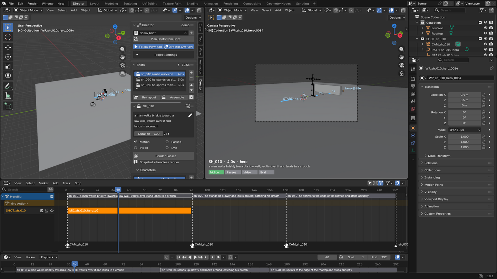

# BlenderMotion

A Blender front end for text → motion → video. A brief becomes shots, and each shot gets
generated motion from Kimodo. You edit the motion in Blender, and MiniMax H3 then renders
the video from Blender's passes. Everything runs on your own GPUs.



**Start with the [tutorial](docs/tutorial.md)**: a clip of each step in the UI, plus real
H3 results.

| Path | What |
|---|---|
| `addon/chimera_director/` | The Blender add-on / extension (4.2 LTS – 5.0) |
| `server/` | Self-hosted orchestrator: Kimodo, headless Blender (retarget, passes), ComfyUI H3, DWPose eval ([README](server/README.md)) |
| `blender_worker/passes.py` | Headless passes worker (kp2d, first/last stills, playblast) |
| `eval/p0`, `eval/p1` | GPU experiments and their findings: motion transfer, speed, multi-camera scenes ([p1 recipe](eval/p1/README.md)) |
| `tools/` | Mock orchestrator and demo scene for add-on development |
| `tests/` | `BLENDER=... tests/run_tests.sh [--e2e \| --e2e-server]`, `pytest tests/test_server.py`, `tests/gui_tour.sh` (tutorial clips) |
| `docs/` | [tutorial](docs/tutorial.md), [architecture](docs/architecture.md), [add-on and contract](docs/addon.md) |

To try the UI without a GPU:

```
python -m server.orchestrator --fake --backend retarget=blender --backend passes=blender --blender /path/to/blender
```
