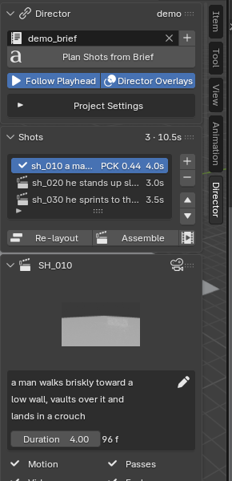
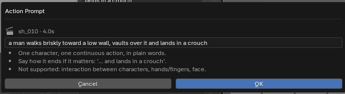

# chimera_director add-on: implementation notes

This covers what the add-on in `addon/chimera_director/` does, the contract it
expects from the orchestrator, and where it departs from
[architecture.md](architecture.md) and why.

Tested on Blender **4.2.23 LTS** and **5.0.1** (`tests/run_tests.sh --e2e`).

## Install

* **Extension (4.2+):** `blender --command extension build --source-dir addon/chimera_director`,
  then *Preferences → Get Extensions → Install from Disk*.
* **Development:** symlink `addon/chimera_director` into
  `<user scripts>/addons/` and enable "Chimera Director".

The UI is in the 3D Viewport sidebar, under the **Director** tab. Set the
orchestrator URL in the add-on preferences (default `http://127.0.0.1:8765`).

## UI

A step-by-step walkthrough with clips is in [tutorial.md](tutorial.md).


* **Director workspace** (button at the top of the panel). Authoring view with
  the sidebar on the left, the active shot's camera on the right, and the NLA
  below, where each shot's motion is a strip on track `SHOT_<id>`.
* **Shot card.** It shows the thumbnail (first frame from the passes), the
  wrapped action prompt (the pencil opens a wide editor), the duration, four
  pipeline chips (Motion, Passes, Video, Eval) with live progress, and one big
  **next step** button. That button always says what the shot needs next:
  add a character, assign a rig, describe the action, generate motion, render
  passes, generate video, or review. Failures and limits (H3 15 s, Kimodo
  ~10 s, multi-character) show as red lines on the card.
* **Viewport overlay.** The camera view gets a HUD with the shot, the prompt and
  the stage chips. Targets get labels (`START · hero`, `hero @ f84`), and the
  root path gets a tick and a label at every second.
* **Timeline / NLA bands.** Each shot is drawn between its markers, coloured by
  state (grey not run, blue running, green done, orange stale, red failed),
  with the active shot outlined and a progress bar while a job runs.
* **Follow Playhead** (on by default). Scrubbing into a shot makes it the
  active shot, and picking a shot in the list moves the playhead into it.
* **Status bar.** It shows running jobs, failures, and "Orchestrator offline".

<p> </p>

`tests/gui_capture.sh` runs the real UI under Xvfb against the mock and
screenshots each pipeline state. Use it after UI changes.

## Backends

The add-on talks to one orchestrator over HTTP. Two implement the contract below.

### Real orchestrator (`server/`)

Self-hosted, stdlib Python 3.10+, no hosted APIs. Each stage is a backend
chosen in a JSON (or TOML, Python 3.11+) config:

| Stage | Backend | Runs |
|---|---|---|
| motion | `kimodo` | `kimodo_gen` in Kimodo's venv on its own GPU; takes ranked from the `.npz`, floating / teleporting takes rejected |
| retarget | `blender` | `server/workers/retarget.py`: BVH onto your rig from the rest pose the add-on sends |
| passes | `blender` | `blender_worker/passes.py` on the snapshot |
| generate | `comfyui` | MiniMax H3 (Ref2V with reference images + playblast, or FLF) on a local ComfyUI |
| eval | `dwpose` | PCK@0.1 of the video vs `kp2d.json` (rtmlib DWPose) |

Every stage also has a `fake` backend (`--fake` for all of them). Example for
an RTX 5090 + RTX 4090 workstation, H3 on GPU0 and Kimodo on GPU1
(`server/config.example.json`):

```jsonc
{
  "blender": "/opt/blender-5.0.1-linux-x64/blender",
  "gpus": {
    "gpu0": {"env": {"CUDA_DEVICE_ORDER": "PCI_BUS_ID", "CUDA_VISIBLE_DEVICES": "0"}},  // 5090
    "gpu1": {"env": {"CUDA_DEVICE_ORDER": "PCI_BUS_ID", "CUDA_VISIBLE_DEVICES": "1"}}   // 4090
  },
  "motion":   {"backend": "kimodo", "device": "gpu1", "venv": "~/kimodo/.venv", "num_samples": 4},
  "retarget": {"backend": "blender"},
  "passes":   {"backend": "blender"},
  "generate": {"backend": "comfyui", "device": "gpu0", "url": "http://127.0.0.1:8188"},
  "eval":     {"backend": "dwpose", "python": "~/dwpose/.venv/bin/python"}
}
```

```
CUDA_DEVICE_ORDER=PCI_BUS_ID CUDA_VISIBLE_DEVICES=0 python main.py --port 8188   # in ComfyUI
python -m server.orchestrator --config server/config.example.json                # in this repo
```

A job holds its GPU's lock only while that stage runs, so Kimodo and H3 never
share a card, and on two cards they run side by side. `GET /health` reports
each backend (Kimodo venv, Blender version, ComfyUI and its H3 nodes, the eval
interpreter) and what each GPU is doing. See [server/README.md](../server/README.md);
the retarget method is documented in `server/workers/retarget.py`.

### Mock (`tools/mock_orchestrator.py`)

```
python tools/mock_orchestrator.py --blender /path/to/blender
blender --python tools/demo_scene.py   # with the add-on enabled: rig, set, 3 shots, targets
```

The mock implements the API below with no models. Motion jobs run a headless
Blender that generates object-level root motion following your START, PATH and
waypoint targets, so you can check the constraint round trip by eye. Passes
jobs render a low-res playblast. Generate jobs copy the playblast as the
"video" and report a random PCK. It is there to exercise the add-on, not to
stand in for the real worker. It produces no keypoints, depth or line art.
`tests/run_tests.sh --e2e` runs the add-on suite against the mock,
`--e2e-server` against `server/` with fake models but the real Blender
retarget and passes workers.

## Workflow in the panel

1. **Project:** set the name and root, create a brief text block, and **Plan Shots
   from Brief**, or add shots by hand with **+**.
2. **Characters:** set `Library` to `assets/hero.blend#HeroRig` and click the
   link icon (this creates a library override), or point `Rig` at any armature.
3. **Targets** (optional): place **Start** first (at the 3D cursor; +Y is the
   facing direction), then **Path**, **Waypoint** (uses the current frame) or
   **Effector**.
4. **Generate Motion:** variants arrive as `MO_<shot>_<char>_v<n>`. Click a
   variant number to swap it in.
5. **Render Passes**, then **Generate Video** (H3: first/last frame or
   reference video). The strips appear in the `<scene>_EDIT` scene.
6. Edit the camera, motion or markers. The affected stages turn *stale*.
   Nothing re-runs until you click.

## Orchestrator contract

All bodies are JSON. Rows marked **added** are not in architecture §6, but the
add-on needs them.

| Call | Body | Response |
|---|---|---|
| `PUT /projects/{p}` **added** | `project.json` fields + `root` | `{}` |
| `PUT /projects/{p}/shots/{s}` **added** | shot JSON (§3.1) | `{}` |
| `GET /projects/{p}/shots/{s}` | | `{shot, stages: {stage: {status, job_id}}}` |
| `POST /projects/{p}/plan` | `{brief, characters: [{char_id, rig}]}` | `{shots: [shot JSON]}` |
| `POST …/shots/{s}/motion` | see below | `{job_id, status}` |
| `POST …/shots/{s}/passes` | see below | `{job_id, status}` |
| `POST …/shots/{s}/generate` | `{model: "h3", mode: "flf"\|"ref2v"}` | `{job_id, status}` |
| `GET /jobs/{id}` | | `{shot, stage, status, progress, artifact, error}` |
| `POST /jobs/{id}/cancel` | | |
| `GET /health` | | flat `{name: status}` dictionary, shown in the panel |

The add-on PUTs the shot JSON before every job. The orchestrator persists it
(`shots/<id>.json`) and derives its cache keys from it. Fields the add-on does
not model, such as `hashes` and `look.style_refs`, round-trip unchanged.

**Motion body.** Spatial targets go with the request, because they are scene
data the orchestrator cannot see:

```jsonc
{
  "frames": 96, "continuity": false, "scene": "Scene", "variant_offset": 4,
  "characters": {
    "hero": {
      "start_matrix_world": [[...4x4...]],  // null if no START placed
      "scale": 0.5,                         // soma_hip / rig_hip; worker divides on the way back
      "rig": {                              // added: rest pose for the retarget worker (absent if no rig)
        "object": "HeroRig", "matrix_world": [[...]], "bonemap": {"pelvis": "Hips", ...},
        "bones": [{"name": "Hips", "parent": null, "matrix_local": [[...]], "length": 0.1,
                   "rotation_mode": "QUATERNION"}, ...]
      },
      "constraints": [
        // root2d uses Kimodo's own field names; heading is [cos, sin] of the yaw
        {"type": "root2d", "frame_indices": [0..n-1], "smooth_root_2d": [[x,z]...], "global_root_heading": [[c,s]...]},
        {"type": "root2d", "frame_indices": [24], "smooth_root_2d": [[x,z]]},  // waypoints without heading
        {"type": "end_effector", "joint": "right_hand", "frame": 40, "position": [x,y,z]}
      ]
    }
  }
}
```

Canonical frame: `(-x, z, y) · scale` of the START-local position, so Y is up,
the character faces +Z, and heading 0 means facing +Z. **Checked against
Kimodo SOMA-RP v1.1 on 2026-10-10**: Y-up, metres, heading 0 faces +Z, left is
+X. Kimodo outputs **30 fps**, so the motion server must resample to 24.
`end_effector` stays in this orchestrator format: Kimodo wants a full pose
there. The server does not IK-solve one yet; it drops these with a job warning.

`rig` (added) is the rig's rest pose and its saved bone map (or the name
guess). The orchestrator rebuilds the armature from it in a headless Blender
and keys the actions for the real rig's bones, so it never opens your file.
Without it the server falls back to the shot's library rig
(`characters[].rig = "file.blend#Object"`), then to unretargeted SOMA actions.

**Reference images (H3 Ref2V)** come from fields that round-trip through the
add-on: `characters[].refs` (per character, tagged `<Picture N>` in the prompt
as that character) and `look.style_refs` (tagged as the look). Paths are
absolute, project-root relative or `//`-relative; at most 9 are sent. Optional
`render.prompt` replaces the generated prompt and `render.seed` the default seed.

**Passes.** With VACE gone, the worker only needs `kp2d.json` (eval),
`first.png` / `last.png` (H3 FLF) and `playblast.mp4` (H3 Ref2V). No pose,
depth or line-art passes.

**Passes body:** `{snapshot_path, scene_hash, scene, frame_in, frame_out
(exclusive), frames, frames_gen, camera, characters: {char_id: rig object
name}, bonemaps: {char_id: {canonical joint: bone}}, resolution: [w, h]}`.
The worker must hide characters that are not in the shot. `bonemaps` is the
rig's saved bone map, or the name guess if none was saved.

**Passes worker** (`blender_worker/passes.py`, run as `blender -b <snapshot>
--python blender_worker/passes.py -- <spec.json>`; the spec is the body plus
`out_dir`). Every output is `frames_gen` frames long (H3's 17k+5 grid at 24 fps;
H3 is trained on 124-362 frames, so shots under ~5.2 s are outside its range): past the out-point the
last pose is held, never trimmed.

* `kp2d.json`: `{format: "coco18", joints, resolution, fps, frame_in,
  frame_out, frames_held, frames: [{i, scene_frame, people: {char_id:
  [[x, y, v] | null] * 18}}]}`. Pixels at the output resolution, origin top
  left. `v = 0` when the joint is off screen or something other than the
  character's own skin over it (within 0.15 m) blocks the ray from the camera.
  Face points (nose, eyes, ears) have no bones and are always `null`, so PCK
  must skip them. Joints come from bone heads: neck bone, upper arm, forearm,
  hand, thigh, shin, foot.
* `first.png` / `last.png`: beauty stills, EEVEE by default.
* `playblast.mp4`: Workbench by default, encoded by Blender's own ffmpeg, so
  the workstation needs no system ffmpeg.

Optional spec keys `still_engine`, `playblast_engine` (`EEVEE`, `WORKBENCH`,
`CYCLES`) and `resolution_scale` (percent). EEVEE and Workbench need an
OpenGL/EGL context; on a box without a GPU, install Mesa's EGL (software GL
works, slowly) or use `CYCLES`. The mock orchestrator defaults to Cycles at 25 %.

**Artifacts.** Job artifacts are applied by key, idempotently, and may be
partial while the job is still running:

| Key | Effect |
|---|---|
| `blend` + `actions: [{char, action, variant}]` | Appends the actions, renames them to `MO_<shot>_<char>_v<n>` after any existing variants, and puts the first one on the NLA |
| `playblast` | Movie strip `PB_<shot>`, channel 1, muted |
| `first` | Shot card thumbnail |
| `video` | Movie strip `VID_<shot>`, channel 2 |
| `audio` | Sound strip `AUD_<shot>`, channel 3 |
| `pck` | PCK badge; marks eval done |

A job's `stage` field may advance within one job (motion → retarget,
generate → eval). The add-on tracks status per stage.

## Deviations from architecture.md

| Doc | Implementation | Why |
|---|---|---|
| §5.2 WS `/events` listener | Polls `GET /jobs/{id}` from a background thread (2 Hz by default) | A WS client in Blender's Python needs a third-party package or a hand-written RFC 6455 client. Polling a few jobs on localhost costs nothing, and the event shape is the same, so only `events.py` would change. |
| §3.2 "selected variant is assigned to the rig" | Each shot's variant is an **NLA strip** on track `SHOT_<id>` at the in-marker | One rig on one shared timeline can't have a different active action per shot. With the NLA it can, and the strips move when shots are re-laid out. You edit motion in NLA tweak mode. |
| §3.2 VSE in the same scene | VSE lives in `<scene>_EDIT` | Strips in the animation scene turn on sequencer post-processing, so every render, including worker passes, would output the edit instead of the 3D scene. |
| §4.1a names `START_<char>`, `WP_<char>_<f>` | `START_<shot>_<char>` etc.; identity comes from custom properties (`chimera_role/shot/char/frame/joint`) | Object names are global in a .blend, so `START_hero` in two shots would turn into `START_hero.001`. |
| §4.1a scale `rig_hip / soma_hip` | `soma_hip / rig_hip` | The doc's ratio is inverted. A rig twice as tall covers twice the ground, so its targets have to shrink going into SOMA space. |
| §5.3 camera matrix *per frame* | Static matrix + camera action keys + constraint targets | Per-frame evaluation needs `frame_set` over the whole shot inside a depsgraph handler, which is slow and re-entrant. Camera motion that comes only from drivers or an animated parent is **not** detected. Click refresh after such edits. |
| §3.1 shot JSON as single source of truth | Markers are authoritative for timing once they exist; `duration_s` follows them | Otherwise dragging a marker and the JSON fight each other. |
| §6 API | Adds `PUT project`, `PUT shot`; motion/passes bodies carry scene data | Without them the orchestrator never sees edits made in Blender. |

## Known gaps

* **Bone map joint names** are a semantic 22-joint core, not SOMA-77 (those names
  weren't available). The retarget worker has to map SOMA onto them, or the
  list gets replaced.
* **`fullbody` constraints** (posed rig on frame f, continuity from the previous
  shot) are not exported. The add-on sends `continuity: true` and leaves it to
  the worker, which has to evaluate the rig anyway.
* **Hashing cost.** It serializes every keyframe of every shot about once a second while
  you edit. That's fine for tens of shots with 77-bone clips; past that it
  needs incremental hashing.
* No segmenting UI (§4.4a). Long shots are sent as one request.
* `SOMA hip height` (preference, default 0.95 m) is a guess.
