# Tutorial: from a brief to a video

This walks one shot through the Director panel: plan, cast, block, generate motion,
render passes, generate video, review. The clips are the real UI on Blender 4.2. They were
recorded by `tests/gui_tour.sh` against `server/` with **fake models**, so the motion is
synthetic and the "video" is the playblast. [Results](#results) shows what the real models
produce.

## Setup

1. Install the add-on: `blender --command extension build --source-dir addon/chimera_director`,
   then *Preferences → Get Extensions → Install from Disk*.
2. Start an orchestrator. To try the UI without GPUs:

   ```
   python -m server.orchestrator --fake --backend retarget=blender --backend passes=blender \
       --blender /path/to/blender
   ```

   For real models, see [server/README.md](../server/README.md).
3. In Blender, open the sidebar (`N`), go to the **Director** tab, and check that the header
   shows the link icon. If it doesn't, set *Orchestrator URL* in the add-on preferences.

You need a set (any geometry), an armature for each character, and a brief in a text block.

## 1. Director workspace

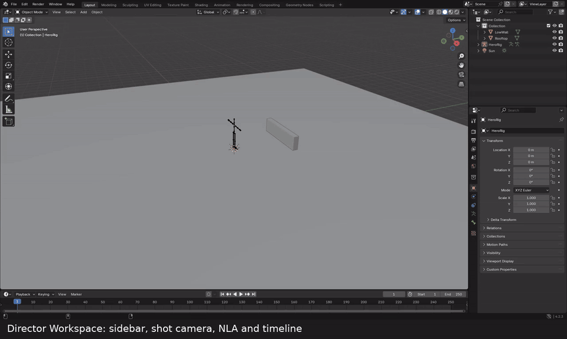

**Director Workspace** builds the layout. On the left is the authoring viewport with the
sidebar. On the right is the active shot's camera. Below are the NLA, with one track per
shot, and the timeline. You only need to do this once per file. [mp4](media/tour/01_workspace.mp4)

## 2. Plan shots from the brief

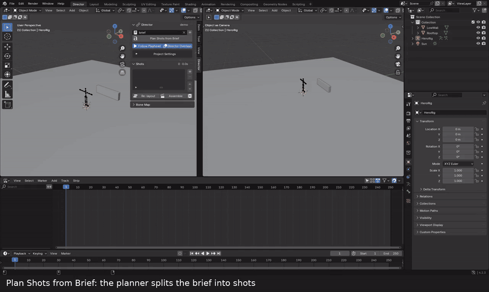

Pick the brief text block and click **Plan Shots from Brief**. Each shot gets a camera, a
collection, and a band on the timeline. The default planner splits the brief one sentence
per shot. With `plan.backend = "llm"`, a local LLM does the split instead. Planning never
re-runs on its own, and shots you have already edited are kept unless you tick
*Overwrite*. You can also add shots by hand with **+**. [mp4](media/tour/02_plan.mp4)

## 3. Characters

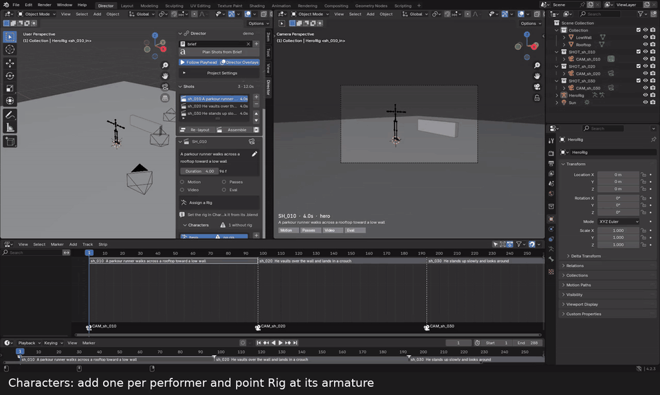

Add one character per performer, then set **Rig** to its armature. You can instead set
*Library* to `file.blend#Object` and click the link icon. The big button on the shot card
always shows what the shot needs next. Here it moves from *Add a Character* to *Assign a
Rig*, and then to *Generate Motion*. [mp4](media/tour/03_character.mp4)

## 4. Action prompt

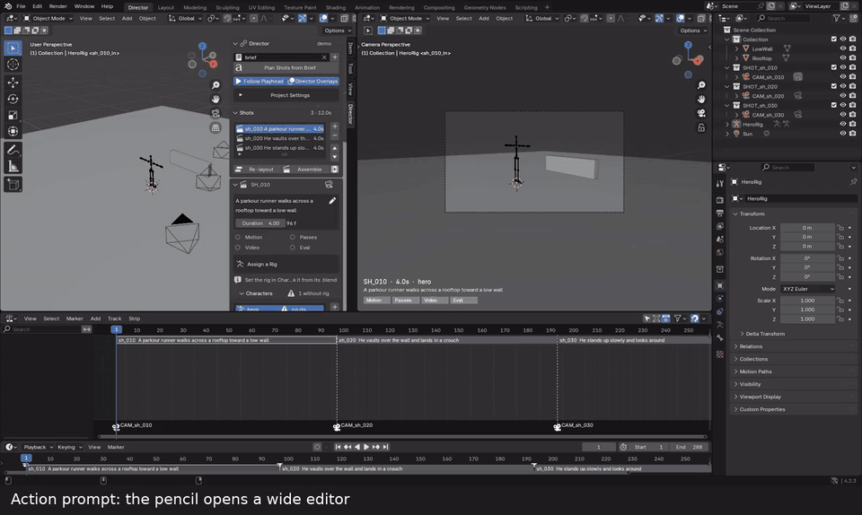

The pencil opens a wide editor. Describe the action, not the look. Keep shots under about
10 s, because Kimodo makes one call per shot. [mp4](media/tour/04_prompt.mp4)

## 5. Targets (optional)

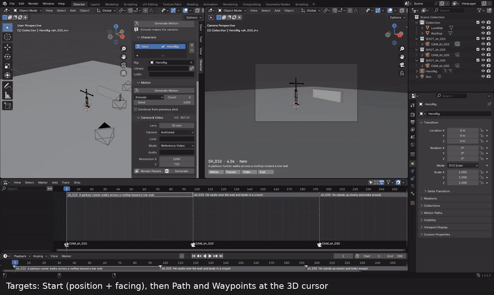

All targets are placed at the 3D cursor.

- **Start:** place it first. It sets where the character starts and which way it faces
  (local +Y).
- **Path:** a curve the root follows. Edit its points like any curve.
- **Waypoint:** pins the root to a spot at the current frame.

The viewport labels each target and puts a tick on the path every second.
**Hand / Foot Target** is sent to the orchestrator, but `server/` currently drops it with a
warning. [mp4](media/tour/05_targets.mp4)

## 6. Generate motion

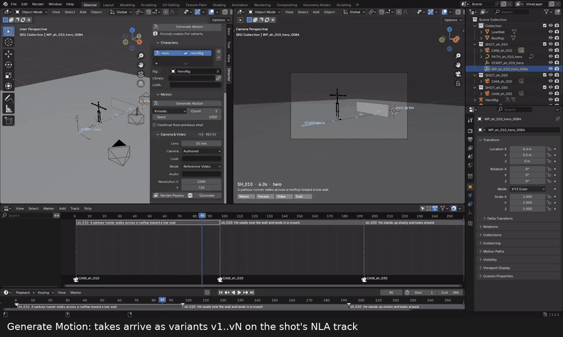

**Generate Motion** runs Kimodo in the background, so you can keep working. The chip shows
progress. Takes that float or teleport are rejected. The survivors arrive as variants
`v1…vN` on the shot's NLA track, retargeted onto your rig. Click a variant number to swap it
in. **Generate More** adds takes. [mp4](media/tour/06_motion.mp4)

## 7. Render passes and generate video

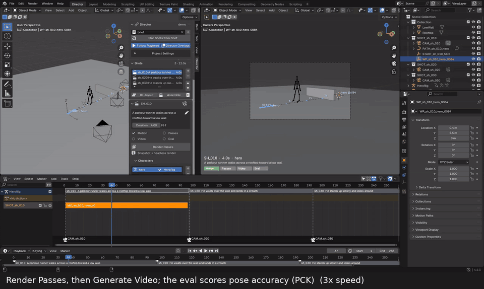

**Render Passes** snapshots the scene and renders headless: the playblast, first and last
stills, and 2D keypoints. The first still becomes the shot's thumbnail. **Generate Video**
sends the playblast to H3 as the reference video, along with any character or style
reference images. When it finishes, the eval scores pose accuracy (PCK@0.1, shown under
**Review**). In this clip the PCK is a random number from the fake backend.
[mp4](media/tour/07_passes_video.mp4)

## 8. Edits make stages stale

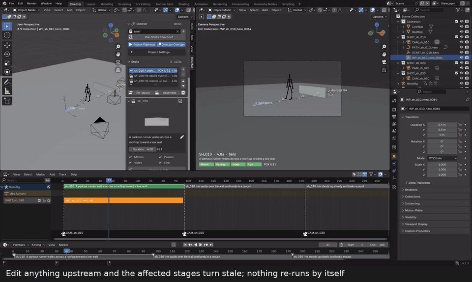

Move a target, the camera, or the motion, and the stages that depend on it turn orange.
Nothing re-runs until you click. Unchanged inputs come back from the cache.
[mp4](media/tour/08_stale.mp4)

## 9. Follow Playhead

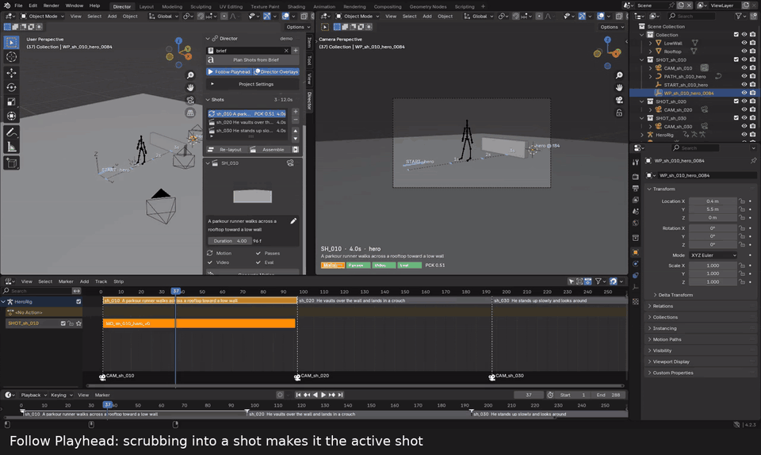

Scrubbing into a shot makes it the active shot, and the camera view follows. Picking a shot
in the list moves the playhead into it. Each timeline band is coloured by state: grey (not
run), blue (running), green (done), orange (stale), red (failed).
[mp4](media/tour/09_follow.mp4)

## 10. Assemble the edit

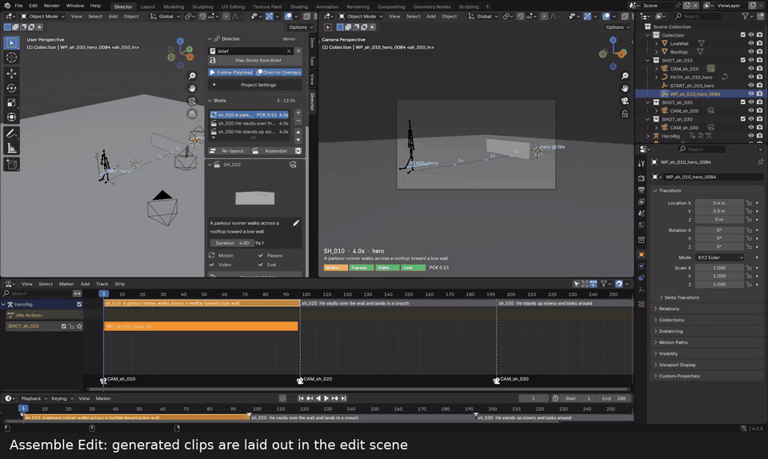

**Assemble** lays the generated clips out in the `<scene>_EDIT` scene, in shot order.
**Open Edit** switches to that scene. [mp4](media/tour/10_assemble.mp4)

## Getting a good result

From the scene tests in [eval/p1](../eval/p1/README.md):

- **Grey mannequins, textured set.** H3 copies textured parts of the reference video almost
  pixel for pixel. Grey figures, though, get re-rendered as real people. Textured rigs come
  out looking like CG.
- **Pass the set image as a reference picture** as well as the set geometry. Without it,
  each camera angle invents a different location.
- **Use a grey ground.** A textured ground smears. H3 paints a believable floor on its own.
- **Draft at 1 MP.** At 2 MP, H3 sometimes pastes the set picture in flat as a backdrop.
  Re-render only the shots that hold up.
- **Render look and FX (haze, depth of field, motion blur) don't carry over** from Blender.
  Describe the look in the prompt.

## Results

These four shots are one two-person performance covered by four cameras. They are
H3 Ref2V output at 1344×768 with the 8-step turbo LoRA, about 4 min per shot on an RTX PRO
6000. The scene was built with the `eval/p1` scripts, not the add-on. The add-on still
generates each character separately, so a staged interaction like this handshake has to be
built that way for now.

| Wide | Two-shot |
|---|---|
| 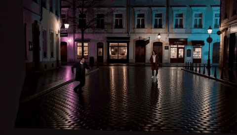 | 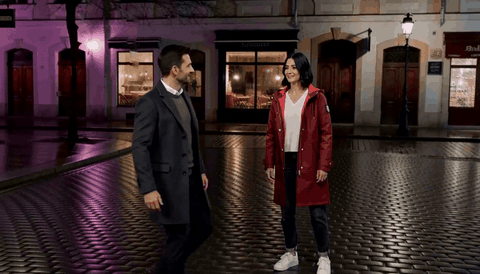 |
| [mp4 with audio](media/results/v5_1_wide.mp4) | [mp4 with audio](media/results/v5_2_two.mp4) |

| Over the shoulder | Close-up |
|---|---|
| 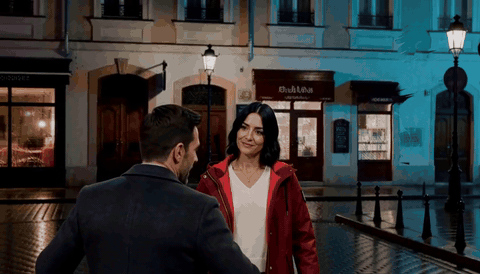 | 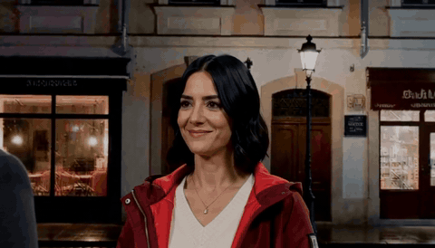 |
| [mp4 with audio](media/results/v5_3_ots.mp4) | [mp4 with audio](media/results/v5_4_close.mp4) |

The image below shows the Blender reference (top) against the H3 output (bottom) for each
camera:

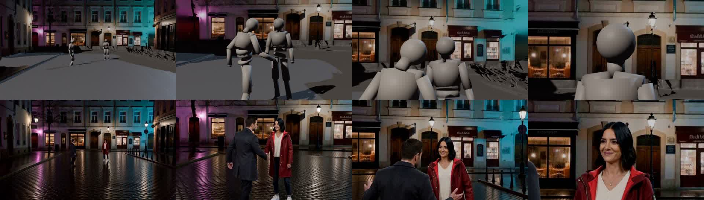

## Re-recording the clips

```
BLENDER=/path/to/blender tests/gui_tour.sh /tmp/tour        # Xvfb, ffmpeg, ImageMagick, xdotool
tests/gui_tour_post.sh /tmp/tour docs/media/tour            # captions, mp4 + gif
```
